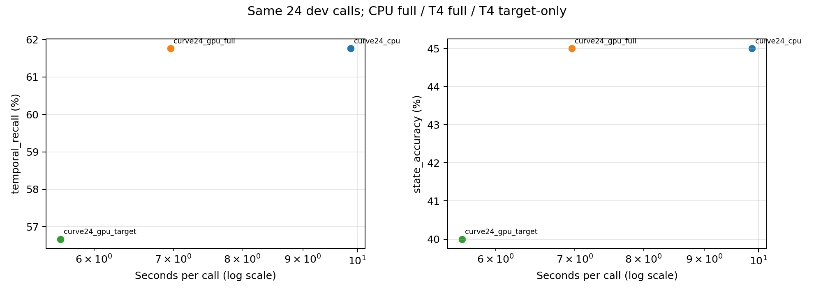

# CompactFactExtraction · команда 3

Innopolis Global Hack, 13–16 ноября 2026. Извлечение фактов из зашумлённых русскоязычных звонков поддержки.

**Финальный вариант: один Qwen2.5-0.5B-Instruct, дообученный LoRA, checkpoint-2142, с объединёнными весами. Без каскада моделей и без `date_extractor`.** 494 032 768 параметров. Даты переводятся из предсказанных смещений в ISO, источники привязываются к исходным репликам по `idx`.

## Результат

Официальный публичный val: 383 звонка, оценщик 2.1. Это сохранённый исходный GPU-прогон выбранного checkpoint. Повторная генерация val упакованной сборкой не завершена; новая сборка отдельно проверена на полном dev.

| Метрика | База организаторов | Наш Qwen |
|---|---:|---:|
| temporal_recall | 47,06% (208/442) | **51,25% (328/640)** |
| state_accuracy | 53,45% (333/623) | **56,82% (354/623)** |
| fact_precision | 33,48% | 51,81% |
| fact_recall | 38,05% | 58,05% |
| grounding_turn | 78,35% | 81,89% |
| grounding_span | N/A | N/A |

Публичные пороги пройдены: temporal ≥45,06% по README (также ≥44,707% по устному уточнению менторов), state ≥51,45%. Grounding_span=N/A: разрешённый `span=null`. Итоговое качество оценивается жюри на скрытом тесте.

Новый полный dev, 385 звонков на T4: temporal 52,13% (318/610), state 56,09% (327/583); среднее **6,401 с/звонок**, p95 **10,378 с**, 562,45 звонка/час, CUDA peak allocated **1,270 GiB**. Нативный CPU Apple M4, 24 заранее выбранных звонка: **9,876 с/звонок**, RSS **2,752 GiB**. Методика, все метрики и три сопоставимых режима: [итоговый отчёт](reports/REPORT.md), [ресурсы](reports/RESOURCE_QUALITY.md).



## Быстрый запуск для жюри

[Release v1.0.0: веса, адаптер и проверенный Docker-образ](https://github.com/romasntlv/compactfactextraction-team3/releases/tag/v1.0.0).

```bash
git clone https://github.com/romasntlv/compactfactextraction-team3.git
cd compactfactextraction-team3
# Нужен GitHub CLI; файлы также можно скачать по ссылке Release выше.
gh release download v1.0.0 --repo romasntlv/compactfactextraction-team3 --pattern qwen-merged.tar.gz --pattern SHA256SUMS
python3 tools/check_downloads.py qwen-merged.tar.gz
tar -xzf qwen-merged.tar.gz
```

### Docker HTTP

Для **Linux ARM64 / Apple Silicon Docker Desktop** готовый проверенный образ:

```bash
gh release download v1.0.0 --repo romasntlv/compactfactextraction-team3 --pattern cfe-qwen-cpu-linux-arm64.tar.gz
python3 tools/check_downloads.py cfe-qwen-cpu-linux-arm64.tar.gz
docker load -i cfe-qwen-cpu-linux-arm64.tar.gz
docker run --rm -p 127.0.0.1:8000:8000 -v "$PWD/models/merged:/models:ro" cfe-qwen:cpu
```

Для Linux x86_64 собирайте CPU-образ на целевой машине:

```bash
docker build --platform linux/amd64 --target cpu -t cfe-qwen:cpu .
docker run --rm -p 127.0.0.1:8000:8000 -v "$PWD/models/merged:/models:ro" cfe-qwen:cpu
```

GPU-сборка и запуск с NVIDIA Container Toolkit:

```bash
docker build --target gpu -t cfe-qwen:gpu .
docker run --rm --gpus all -p 127.0.0.1:8000:8000 -v "$PWD/models/merged:/models:ro" cfe-qwen:gpu
```

ARM64 CPU Docker проверен реальными HTTP-запросами. x86_64 CPU и CUDA Docker **не проверены**; GPU-замеры получены в Colab T4 вне Docker. Веса монтируются отдельно, интернет при инференсе не нужен. В другом терминале:

```bash
curl http://127.0.0.1:8000/health
python3 tools/demo.py
```

`POST /extract`: JSON с `call_id`, `started_at`, `turns` (`idx`, `speaker`, `text`). Выход — `call_id` и `facts`. Вход не должен содержать `facts`. OpenAPI: http://127.0.0.1:8000/docs. Сценарий живой демонстрации: [DEMO.md](docs/DEMO.md).

### Локально без Docker

```bash
python3.11 -m venv .venv
source .venv/bin/activate
pip install torch==2.8.0 --index-url https://download.pytorch.org/whl/cpu
pip install -r requirements.lock
python -m src.cli --input data/curve24_input.jsonl --output /tmp/cfe_predictions.jsonl --device cpu --dtype float32 --threads 4 --warmup
python tools/score.py data/curve24_gold.jsonl /tmp/cfe_predictions.jsonl /tmp/cfe_metrics.json
```

Подробные инструкции, продолжение прогона, частичные ответы, подготовка базы и обучение: [RUNBOOK.md](RUNBOOK.md).

## Воспроизведение

```bash
# Проверки контракта и переноса codec, без генерации модели
python -m unittest discover -s tests -v
python tools/verify_raw_codec.py
# Официальная оценка сохранённого val, достаточно стандартного Python
python evaluation/case_metrics.py data/val_gold.jsonl data/val_reference.jsonl
# Восстановление точных обучающих окон, проверяет SHA256
python train/build_training.py
# Обучение: одна T4, около 4,1 часа исходного запуска, seed 42, две эпохи
python train/train.py --epochs 2 --train-data train/prepared/train_augmented.jsonl --output train/run
```

Исходные train/val организаторов синтетические. Train/dev разделены по аккаунтам (3541/385 звонков); val — 383 звонка. Добавлены 1600 окон контрастных примеров. Код, split, manifest и аугментации включены. Отдельного контроля Qwen без аугментации нет. При повторном обучении checkpoint выбирается по dev, а не по val. Для пересборки исходного checkpoint скачайте `qwen-adapter.tar.gz`, распакуйте в корень, выполните `tools/fetch_base.py` и `tools/merge_model.py`; ревизия базы закреплена.

## Карта сдачи

- [Соответствие требованиям и оставшиеся ограничения](docs/SUBMISSION_CHECKLIST.md).
- [Отчёт: архитектура, обучение, ошибки, дальнейшее развитие](reports/REPORT.md).
- [Три режима: качество, latency, память, throughput](reports/RESOURCE_QUALITY.md).
- [Презентация](presentation/CompactFactExtraction_team3_v2.pptx), [текст выступления](presentation/Выступление_7_минут.md).
- [Понятное описание и Q&A](PROJECT_GUIDE.md).
- [История сравнений](docs/comparison_history.md) — архив исследования; актуальные данные релиза выше.
- [Кейс и критерии](docs/case/), [схема](docs/case/schema.md), [ответы организаторов](docs/case/ANSWERS_v2.md).
- `benchmarks/` — поэлементные времена, сырые ответы и ресурсные журналы; `reports/` — оценка и разбор ошибок.
- [Происхождение и лицензии](THIRD_PARTY_NOTICES.md).

**Команда:** Санталов Роман, Гришаев Иван, Файрушин Данияр, Галиев Дамир, Низамов Камиль.
