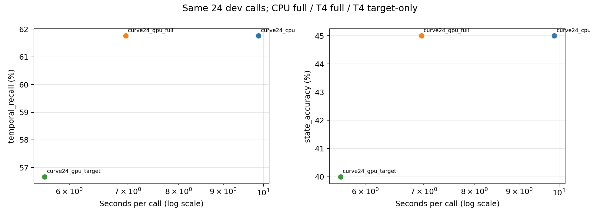

# Измеренные результаты релизной проверки

| Режим | Звонки | Temporal | State | Precision | Recall | Grounding turn | Среднее, с | p95, с |
|---|---:|---:|---:|---:|---:|---:|---:|---:|
| dev_gpu_full | 385 | 52.13% (318/610) | 56.09% (327/583) | 50.73% | 57.40% | 81.85% | 6.401 | 10.378 |
| curve24_gpu_target | 24 | 56.67% (17/30) | 40.00% (16/40) | 51.69% | 53.04% | 78.69% | 5.623 | 8.290 |
| stress96_mild_gpu | 96 | 53.57% (90/168) | 58.78% (87/148) | 50.99% | 57.33% | 86.05% | 6.374 | 10.437 |
| curve24_cpu | 24 | 61.76% (21/34) | 45.00% (18/40) | 45.39% | 55.65% | 76.56% | 9.876 | 13.918 |
| curve24_gpu_full | 24 | 61.76% (21/34) | 45.00% (18/40) | 45.39% | 55.65% | 76.56% | 6.960 | 10.159 |
| stress96_gpu_full | 96 | 55.95% (94/168) | 58.78% (87/148) | 51.00% | 56.44% | 87.01% | 6.294 | 9.927 |

Grounding_span=N/A: спаны не предсказываются. Режимы сравнивать на одинаковом наборе. Память и оборудование — в *.segments.jsonl; для подвыборок GPU память относится к полному исходному прогону. GPU wall-time/1000 — экстраполяция, не время CUDA-ядер.

