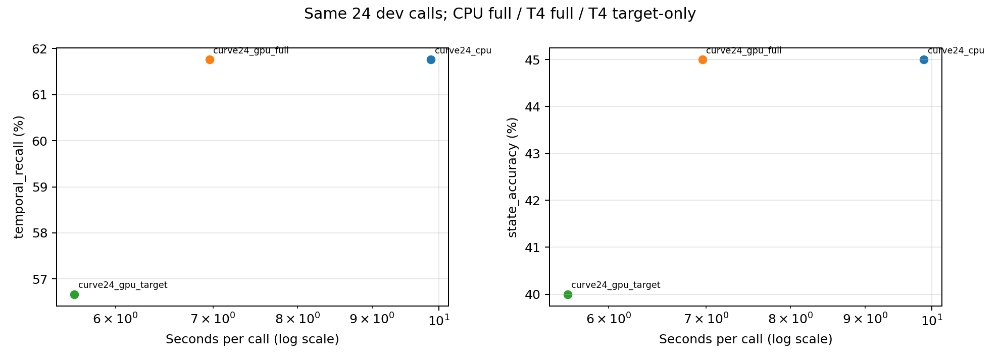

# Отчёт релиза Qwen — CompactFactExtraction

Дата актуализации: 16 ноября 2026. Основной режим зафиксирован. Презентация и сценарий живой демонстрации включены; веса и Docker-образ поставляются через GitHub Release.

## Архитектура и обучение

Qwen2.5-0.5B-Instruct + LoRA r32, checkpoint-2142. На инференсе один merged decoder, greedy generation. Окна: 6 целевых реплик, по 3 соседних и до двух дальних упоминаний номера заявки. Модель выдаёт компактный JSON: источник, атрибут, объект, значение, полярность и смещения дат. Код преобразует смещения в ISO и берёт speaker/quote из исходных turns. Каталог не превращается в закрытый список допустимых значений.

Сохранённая prompt-аннотация относительных дат использует только текст/started_at. Присоединение date_extractor отвергнуто на dev: сохраняющие набор фактов варианты снижали temporal; исходный вариант удалял факты и ухудшал остальные метрики. Релиз не содержит такого постпроцессора.

Обучение: исходный синтетический корпус организаторов, 3541 звонок train и 385 dev по аккаунтам; 15 533 исходных окна + 1600 дополнительных окон ловушек; 2 эпохи, seed42. Выбор эпохи по dev. Отдельного Qwen-контроля без дополнительной синтетики нет: вклад аугментации причинно не измерен.

## Воспроизведённые метрики сохранённого запуска

| Срез | Temporal | State | Precision | Recall | Grounding turn |
|---|---:|---:|---:|---:|---:|
| dev, 385 звонков | 52.22% (318/609) | 56.09% (327/583) | 50.71% | 57.34% | 81.93% |
| val, 383 звонков | 51.25% (328/640) | 56.82% (354/623) | 51.81% | 58.05% | 81.89% |

База организаторов на val: temporal 47,06% (208/442), state 53,45% (333/623), precision 33,48%, recall 38,05%, grounding_turn 78,35%. Grounding_span=N/A для нашего выхода; span=null разрешён схемой. Temporal считается среди сопоставленных фактов с проверяемыми датами, а не среди всех gold-фактов. Поэтому всегда показываем знаменатель и соседние метрики.

Пройдены оба варианта temporal-порога: 44,707% по уточнению менторов и 45,06% из README; state ≥51,45%. Это результат публичного val, не обещание скрытого теста.

## Ошибки по атрибутам — dev (основа анализа)

| Атрибут | Precision | Recall | Temporal | State | Grounding turn |
|---|---:|---:|---:|---:|---:|
| service_state | 48.83% | 50.22% | 32.91% | 35.22% | 86.03% |
| tariff | 63.87% | 70.52% | 20.24% | 61.67% | 80.33% |
| ticket_status | 87.32% | 92.79% | 55.83% | 90.74% | 92.91% |
| action | 36.15% | 52.82% | N/A | N/A | 91.37% |
| agreement | 38.43% | 39.46% | 90.55% | N/A | 51.31% |

У статусов заявок высокая полнота фактов (92,79%), но temporal 55,83%: основная трудность — различить начало старого статуса и дату перехода. Тарифы дают temporal 20,24%, а состояния услуг — state 35,22%: остаются ошибки даты и объекта. Договорённости, которые удалось сопоставить, имеют temporal 90,55%, но recall лишь 39,46% и grounding_turn 51,31%: хороший срок у найденных фактов не компенсирует пропуски и неверный источник. У действий precision 36,15%; требуется осторожность с неподтверждёнными и неверно сформулированными фактами.

Из 609 проверяемых dev-интервалов неверны 291: только valid_from — 181, только valid_to — 22, обе границы — 88. Среди сопоставленных фактов неверная реплика — 187. Не сопоставлены 770 gold и 1006 предсказаний; эти числа не классифицируют автоматически причину (объект, значение, полярность или ложный факт).

Пример dev u101_00020:call0001: «сначала … принята, а вчера … в работе». Модель верно закрыла старый статус 27 мая, но также поставила его начало 27 мая; gold требует 25 мая. Это демонстрирует смешение даты перехода с началом предыдущего состояния. В иных примерах старые даты в эталоне неочевидны из ближайших реплик; такие случаи не следует выдавать за однозначно исправляемые правилами.

Полные списки расхождений с gold/pred — *_reference_score.json.errors.jsonl. Val используется только для оценки и отчёта; новые правила по нему не подбираются.

## Ресурсный критерий

Qwen после merge: 494 032 768 параметров. В README организаторов baseline назван glm-5.3. В [официальной карточке AWS GLM-5.3](https://docs.aws.amazon.com/bedrock/latest/userguide/model-card-zai-glm-5-3.html), проверенной 15.11.2026, указаны 753 млрд всего, 744 млрд без MTP и около 40 млрд активных на токен. Консервативное отношение 744 млрд / 494 032 768 ≈ 1506× превышает критерий 10× по общему числу параметров. Это сопоставление заявленного baseline с публичной архитектурой, не замер его ускорения. Активные параметры MoE не смешиваем с общим размером модели.

Прежний T4-прогон val: 5,709 с/звонок, 630,59 звонка/час; 1,258 GiB peak allocated, 2,854 GiB peak reserved. GPU wall-time/1000 = 5708,90 с (пересчёт); загрузка модели/HTTP исключены. Прежних p95 и CPU RSS нет. Новые поэлементные замеры находятся в benchmarks и сводятся tools/summarize_run.py. Три точки теперь измерены: см. [ресурсный отчёт](RESOURCE_QUALITY.md). Старый val и новые dev-замеры разделены.

## Регрессия, шум и ограничения

Из сохранённых сырых ответов новый codec точно воспроизвёл 385/385 dev и 383/383 val; проверены поля, источники, интервалы и пустые facts. На dev исходной генерации было 1 невалидное JSON-окно и 3 невалидные строки; на val — 0. Публичный API отражает частичные результаты заголовками, а не скрывает ошибки как успешную пустоту.

Stress-test подготовлен до новых прогонов: 96 dev-звонков, два уровня фонетических замен и слов-паразитов, seed20261115; даты, номера и отрицания не меняются. Спаны эталона отключены, поскольку текст изменён. Это ограниченная проверка семантически сохраняемого шума; она не моделирует пропавшие отрицания, искажённые номера и все виды скрытого adversarial. Отдельно пять ручных ловушек с ожидаемым facts:[]. Умеренный шумовой GPU-прогон завершён; сильный шум и GPU-повтор ловушек не завершены. Актуальные результаты ниже.

CPU/GPU FP32/FP16, Torch и CPU merge могут менять greedy-выходы около равных logits. Поэтому сравнение сырых строк дополняется полной оценкой качества упакованной модели; побитовое совпадение между устройствами не обещается.

## Развитие после сдачи

Self-training на реальных обезличенных звонках с выборочной проверкой спорных интервалов учителем; отдельная проверка переносимости на новые шаблоны, контрастные примеры разных заявок и подтверждений; явная привязка события к времени и объекту; расширение атрибутов и языков. Учитель — только этап подготовки данных, не каскад рабочего инференса. Это будущие идеи, не реализованные свойства релиза.

## Новые локальные результаты упаковки

CPU Apple M4, 24 GB RAM, 4 потока, FP32, Torch 2.13.0: 24 заранее выбранных dev-звонка, mean 9,876 с, p50 9,257 с, p95 13,918 с, 364,54 звонка/час, sampled peak RSS 2,752 GiB. Загрузка 0,407 с, прогрев 6,069 с отдельно. Во время прогона в фоне загружались зависимости Docker; это одиночный замер, без доверительных интервалов.

На этих 24 звонках temporal 61,76% (21/34), state 45,00% (18/40), precision 45,39%, recall 55,65%, grounding_turn 76,56%. **Все официальные метрики в точности совпали с исходными GPU-предсказаниями на тех же 24 звонках**; полные JSON совпали у 18/24. Низкий state этого поднабора был таким же до упаковки: это не обнаруженная регрессия, но и не доказательство порогов на полном корпусе.

На пяти коротких ручных negative-only проверках CPU-модель правильно оставила пустым только 1/5 звонков (гипотеза). На неподтверждённом предложении, отвергнутой догадке, чужой услуге и неподтверждённой цитате появились ложные факты. Эти результаты сохранены в traps_cpu.json; нельзя заявлять, что ловушки полностью решены. Пять коротких примеров не оценивают частоту ошибок на полном корпусе, но показывают слабую переносимость на такие формулировки. Релиз не подгоняется под эти пять примеров; GPU-повтор включён в Colab.

## Docker / HTTP — измеренная проверка

Linux ARM64 CPU-образ успешно собран и запущен в Docker Desktop на Mac. Три настоящих HTTP-запроса: 27,397 / 28,818 / 38,874 с; среднее 31,696 с. Первый запрос включён, прогрева нет, загрузка модели исключена. Это небольшой smoke-набор из первых трёх звонков curve24, **не сопоставимый полный ресурсный прогон**. Виртуализированный Linux с Torch 2.8.0+cpu заметно медленнее нативного macOS/Torch 2.13.0; замер нельзя смешивать с 9,876 с нативного CPU.

Проверены 200/health, пустые turns → facts:[], отказ 422 на входной gold и неверную дату, schema/source всех трёх реальных ответов. Образ — 1,225 GiB без весов (weights read-only volume); точный ID и зависимости сохранены в docker_cpu_image.json и docker_cpu_environment.freeze.txt. Linux x86_64 и CUDA-контейнер на этом Mac не проверены.

## Завершённые Colab-проверки и кривая трёх режимов

Новый полный dev (385): temporal **52,13% (318/610)**, state **56,09% (327/583)**, precision **50,73%**, recall **57,40%**, grounding_turn **81,85%**. 338/385 записей полностью совпадают с исходным dev, 10 строк facts:[], 3 частичных ответа. Среднее 6,401 с, p95 10,378 с. Это результат релизной сборки на T4, отдельно от исходного val.

На одинаковых 96 звонках умеренное усиление шума: temporal **55,95% (94/168) → 53,57% (90/168)**, state **58,78% (87/148) → 58,78%**, precision **51,00% → 50,99%**, recall **56,44% → 57,33%**, grounding_turn **87,01% → 86,05%**. Это ограниченная самопроверка, не скрытый adversarial жюри.

[Все три точки, память, оборудование и методика](RESOURCE_QUALITY.md).

Отдельный слайд об ограничениях исключён по решению команды. Ограничения сохранены в этом отчёте и подготовке Q&A; на защите следует учитывать требование кейса об анализе ограничений.
