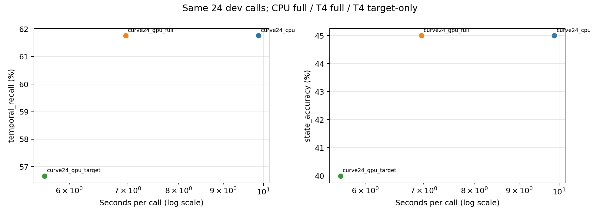

# Ресурсы × качество: три измеренных режима

Одинаковые 24 dev-звонка, отобранные по длине текста без обращения к эталону. 494 032 768 параметров во всех режимах.

| Режим | Mean, с | p50, с | p95, с | Звонков/ч | Wall-с/1000 | RSS, GiB | CUDA allocated / reserved, GiB | Temporal | State | Precision | Recall | Grounding turn |
|---|---:|---:|---:|---:|---:|---:|---:|---:|---:|---:|---:|---:|
| Apple M4 CPU FP32, full | 9.876 | 9.257 | 13.918 | 364.54 | 9875.53 | 2.752 | N/A | 61.76% (21/34) | 45.00% (18/40) | 45.39% | 55.65% | 76.56% |
| T4 FP16, full | 6.960 | 6.725 | 10.159 | 517.24 | 6960.02 | 2.616 | 1.270 / 2.699 | 61.76% (21/34) | 45.00% (18/40) | 45.39% | 55.65% | 76.56% |
| T4 FP16, target-only | 5.623 | 5.593 | 8.290 | 640.26 | 5622.70 | 2.710 | 1.086 / 1.258 | 56.67% (17/30) | 40.00% (16/40) | 51.69% | 53.04% | 78.69% |

Grounding_span=N/A во всех режимах. Для CPU wall-с/1000 не являются GPU-секундами; для T4 это экстраполяция синхронизированного времени полного извлечения на одной GPU, а не отдельный профилированный kernel busy time.

**Пик памяти T4 full относится к полному исходному dev-прогону из 385 звонков**, из которого выбраны 24 строки и их latency. Остальные пики относятся к соответствующим 24 звонкам. Низкий state малого поднабора не заменяет оценку порогов на полном val.

CPU: Apple M4, 24 GB RAM, 4 потока, macOS 15.7.4, Torch 2.13.0, FP32. GPU: Tesla T4, Linux x86_64, Python 3.13.16, Torch 2.8.0+cu128, Transformers 4.57.1, PEFT 0.17.1, FP16. Загрузка/прогрев отдельно в segments. CPU-прогон единичный, в фоне шла загрузка Docker-зависимостей; доверительные интервалы не оценивались.

Таймер включает токенизацию, генерацию, декодирование и проверки. CUDA синхронизирована. Исключены загрузка модели, HTTP и файловый ввод/вывод. RSS семплируется каждые 20 мс. Throughput = 3600 / mean; параллельная нагрузка не измерялась.



Полные численные результаты: [RESULTS.md](../benchmarks/colab_partial_20261116/reports/RESULTS.md), [all_metrics.json](../benchmarks/colab_partial_20261116/reports/all_metrics.json). Нативный CPU и CPU Docker — разные окружения; HTTP Docker smoke-test mean31,696 с на трёх звонках не смешивается с этой таблицей.

## Воспроизведение отчёта

```bash
pip install matplotlib==3.10.7
python tools/summarize_run.py benchmarks/colab_partial_20261116
```
